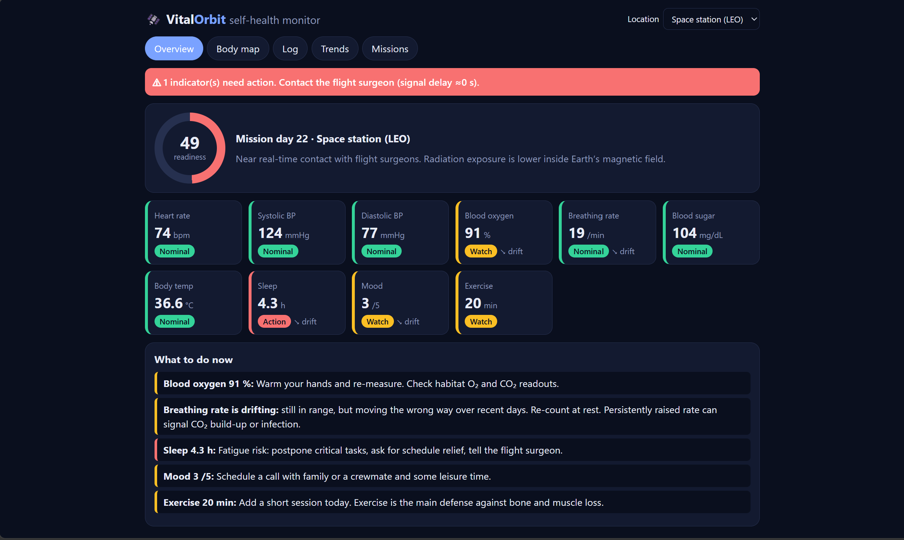

# 🛰️ VitalOrbit

**A self-health monitor that helps astronauts spot, understand and act on changes in their own health during long space missions.**

Built for the **NASA Space Apps Challenge 2026**: *Create Health Monitoring Software for Astronauts on Space Missions*.

  -->
<!-- Live demo: https://your-demo-link -->

---

## The problem

On long missions to the Moon or Mars, help from Earth can be minutes away, and astronauts are exposed to radiation, isolation, altered gravity and a closed environment. These hazards can bring immune changes, bone loss, cardiovascular problems and behavioral health issues. Astronauts must be able to assess their own health, and not all of them are medical experts.

## The solution

VitalOrbit is designed from the **astronaut's point of view**. It collects ten health indicators, colour-codes them at a glance, explains what each one means, spots slow "drift" before a value leaves its safe range, and tells the astronaut exactly what to do, including when to contact the flight surgeon.

## Features

| Feature | What it does |
|---|---|
| **Overview dashboard** | Readiness score, ten colour-coded indicator cards (green / amber / red) and a "what to do now" action list |
| **Interactive body map** | Click the head, chest, gut, arms or legs to see the related hazard, why it matters, how to measure it and the advised action |
| **Guided logging** | Daily entry form with a plain-language "how to measure" hint under every field |
| **Trend charts** | Last 21 days per indicator, with the nominal range shaded and each point coloured by status |
| **Drift detection** | Flags values that are still in range but moving the wrong way over recent days |
| **Location awareness** | Space station, deep-space transit, lunar base or rover: changes the signal delay and context shown |
| **Gamification** | XP, levels, logging streak and daily health tasks. XP is kept when a new day starts |
| **Reminders** | Configurable measurement reminders (in-app banner plus optional browser notifications) |
| **Flight surgeon export** | One-click summary (.txt) and raw data (.csv) for the medical team on the ground |
| **Hazard explainers** | NASA's five spaceflight hazards and how the app tracks each one |

### Indicators tracked

Heart rate, systolic and diastolic blood pressure, blood oxygen (SpO₂), breathing rate, blood sugar, body temperature, sleep, mood and exercise minutes.

## How it works

```
React (Vite)  ──HTTP /api──▶  FastAPI (Python)  ──▶  data.json
 UI only                      health rules, drift, readiness, XP, reports
```

- **Python owns the logic.** Each indicator has a *watch* range and an *action* range. A value outside the watch range is amber, outside the action range is red.
- **Drift:** the latest value is compared with the average of the previous four readings. If it moves in the harmful direction by more than a per-indicator threshold, it is flagged.
- **Readiness score:** starts at 100, minus 18 per red indicator, 7 per amber and 3 per drifting indicator.
- **XP:** +10 per logged entry, +5 per fully healthy day, plus daily task XP. Task XP is banked when a new day starts.
- **React is a thin UI.** It renders whatever the API returns, so the rules live in exactly one place (`backend/main.py`).

## Getting started

**Requirements:** Python 3.10+, Node.js 18+

```bash
git clone https://github.com/Yii0909/vitalorbit.git
cd vitalorbit

# Terminal 1: backend
cd backend
python -m venv .venv && source .venv/bin/activate    # Windows: .venv\Scripts\activate
pip install -r requirements.txt
uvicorn main:app --reload --port 8000

# Terminal 2: frontend
cd frontend
npm install
npm run dev                                          # open http://localhost:5173
```

The first run creates `backend/data.json` with 14 days of demo data so trends and drift flags show immediately. Delete the file to reset.

Interactive API docs: http://localhost:8000/docs

## Project structure

```
vitalorbit/
├── backend/
│   ├── main.py             # FastAPI app: rules, XP, reports, endpoints
│   └── requirements.txt
└── frontend/
    ├── index.html
    ├── vite.config.js      # proxies /api to :8000
    └── src/
        ├── main.jsx
        ├── App.jsx         # Overview, Body map, Log, Trends, Missions
        └── styles.css
```

## API

| Method | Endpoint | Purpose |
|---|---|---|
| GET | `/api/config` | Indicator definitions, body regions, locations, tasks, hazards |
| GET | `/api/state` | Entries, statuses, insights, readiness, XP |
| POST | `/api/entries` | Add or replace a daily entry |
| POST | `/api/tasks/{id}` | Tick or untick a daily task |
| POST | `/api/new-day` | Bank task XP and reset the daily tasks |
| PUT | `/api/env/{env}` | Change location (`iss`, `transit`, `moon`, `rover`) |
| PUT | `/api/reminders` | Save reminder settings |
| GET | `/api/report` | Flight surgeon summary (text) |
| GET | `/api/export.csv` | All readings as CSV |

## Limitations and disclaimer

- **Not a medical device.** VitalOrbit is an educational hackathon prototype. Reference ranges are simplified adult resting values chosen for demonstration and have not been clinically validated. Always follow guidance from a flight surgeon.
- Readings are entered manually; there is no live sensor integration yet.
- Reminders fire only while the page is open.
- Storage is a local JSON file, suitable for a single user.

## Sources and how they were used

I read all five pages provided with the challenge and used them as follows. Explanations in the app paraphrase these pages and show a "Source" line on the body map.

| Source | What it informed in VitalOrbit |
|---|---|
| [NASA HRP: The five hazards](https://www.nasa.gov/hrp/hazards/) | The five hazard names and descriptions (radiation, isolation and confinement, distance from Earth, gravity fields, hostile/closed environments) in the hazard list and body map |
| [NASA HRP: Risks of human spaceflight](https://www.nasa.gov/hrp/risks/) | Which health risk each indicator relates to: immune responses (temperature), cardiovascular adaptations and hypoxia (heart rate, blood pressure, blood oxygen), inadequate food and nutrition (blood sugar), reduced fitness and bone changes (exercise), sleep and behavioral risks (sleep, mood) |
| [NASA HRP: Ongoing research](https://www.nasa.gov/hrp/ongoing-hrp-research/) | Design inspiration only: consistent standard measures (Standard Measures), wrist-based sleep and activity tracking (ARCHeR), and sharing health data with the ground (Tempus Pro) |
| [CSA: Monitoring radiation for astronaut health](https://www.asc-csa.gc.ca/eng/news/articles/2026/2026-02-26-monitoring-radiation-astronaut-health.asp) | Radiation is a key challenge beyond Earth's atmosphere; used in the radiation hazard note |
| [CSA: Why do we conduct science experiments in space?](https://www.asc-csa.gc.ca/eng/iss/science/why-do-we-conduct-science-experiments-in-space.asp) | Moon and Mars missions bring more weightlessness, radiation, isolation, communication delays and less emergency medical help |

**Not taken from these sources:** all reference ranges and thresholds, the drift rule, readiness score, XP system and the signal-delay figures are this project's own simplified choices. **Not monitored by the app:** radiation dose, eye and vision changes (SANS), balance and motion sickness, decompression sickness.

## Use of Super Intelligence (SI)

This project was built with assistance from Claude (Anthropic), a large language model.

- **Code:** the React frontend and Python (FastAPI) backend were generated with Claude and reviewed by the team.
- **Data:** the demo health data is synthetic and was generated with Claude's help.
- **Images:** the app icon was designed with Claude (SI-generated).
- **Text:** the README and descriptions were drafted with Claude and edited by the team.

No NASA logos, flags or mission identifiers are used.

## Team

Team Stellar Seekers 2.0

Team Members:
- Teo Yii Xian ([@Yii0909](https://github.com/Yii0909))
- Che'nelle Alva
- Amelia Wong Zhi Lin
- Hebe Tan Cze Yi
